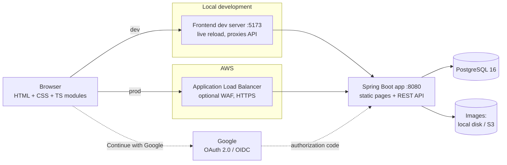
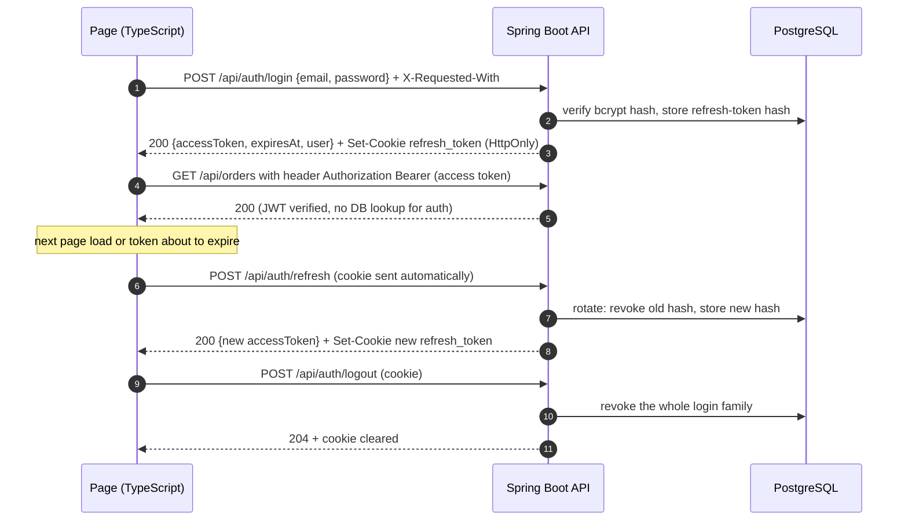
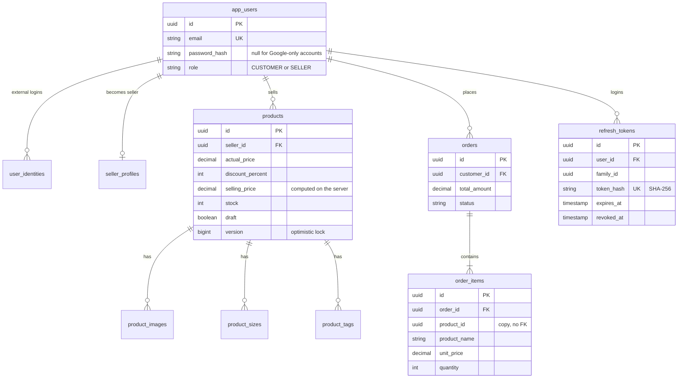

# Bilal's Mens Wear — E-Commerce

[](https://github.com/zaheenmunshi/E-Commerce-Website/actions/workflows/ci.yml)
[](https://github.com/zaheenmunshi/E-Commerce-Website/actions/workflows/codeql.yml)

A clothing store: shoppers browse and search the catalogue, keep a cart and a wishlist, and
check out; sellers apply for a seller account, list products (with drafts and image
uploads) and manage their listings. The frontend is plain HTML, CSS and TypeScript with no
framework; the backend is a Spring Boot REST API secured as an OAuth 2.0 resource server
with JWT access tokens and rotating refresh tokens; data lives in PostgreSQL; the AWS
infrastructure is defined in Java with the AWS CDK.

---

## Contents

- [Tech stack](#tech-stack)
- [Architecture](#architecture)
- [Authentication & tokens](#authentication--tokens)
- [Security checklist](#security-checklist)
- [Getting started](#getting-started)
- [Configuration](#configuration)
- [API reference](#api-reference)
- [Database](#database)
- [Testing](#testing)
- [Deployment (AWS)](#deployment-aws)
- [Modern Java in this codebase](#modern-java-in-this-codebase)
- [Project structure](#project-structure)
- [Contributing](#contributing)

---

## Tech stack

| Layer | Technology |
|---|---|
| Frontend | HTML5, CSS3, **TypeScript 7** (strict), native ES modules — no framework, no bundler, no runtime npm dependencies |
| Backend | **Java 25 (Amazon Corretto)**, **Spring Boot 4.1**: Spring MVC, Spring Data JPA / Hibernate 7, Spring Security 7 (OAuth 2.0 Resource Server + OAuth 2.0 Client), Bean Validation, Mail, Actuator |
| Build | Maven (wrapper included) with the **Spring Boot BOM** (via `spring-boot-starter-parent`) and the **AWS SDK BOM**; npm for the TypeScript compiler |
| Database | **PostgreSQL 16** (H2 in PostgreSQL mode for tests) |
| File storage | Local disk in development, **Amazon S3** on AWS |
| Infrastructure | **AWS CDK v2 in Java**: ECS Fargate, Application Load Balancer, RDS PostgreSQL, S3, Secrets Manager, CloudWatch Logs, optional AWS WAF |
| CI/CD | GitHub Actions (CI, CodeQL, manual deploy via GitHub OIDC), Dependabot |
| Container | Multi-stage `Dockerfile` on `amazoncorretto:25-alpine`, non-root, read-only root filesystem on AWS |

---

## Architecture



The Spring Boot app serves the compiled frontend as static files (in development straight
from `frontend/dist`, in the jar from `classpath:/static`) and maps pretty URLs such as
`/products/{id}` to the HTML pages. Each page loads one TypeScript module, which calls the
JSON API under `/api`.

### Backend package layout

Package-by-feature, with the same layers inside every feature. Dependencies point inward:
**`web` → `service` → `domain`** (`dto` records are shared by `web` and `service`).

| Package (`com.zaheenmunshi.ecommerce.*`) | Responsibility |
|---|---|
| `auth` | Signup, password login and the token endpoints (`web`, `service`, `dto`) |
| `user` | Accounts and linked external identities (`domain` only) |
| `seller` | Becoming a seller and the seller dashboard API |
| `product` | Catalogue: listings, tags, sizes, pricing, search |
| `order` | Checkout with server-side prices and stock, order history, confirmation mail |
| `storage` | Product images behind the `ImageStorage` interface: `local` and `s3` implementations, upload validation, serving |
| `security` | `SecurityConfig`, the authenticated principal, and `jwt` (access tokens), `refresh` (refresh-token rotation), `oauth` (Google login), `guard` (rate limit, lockout, password policy) |
| `common` | `BaseEntity` (UUID id + timestamps) and API error handling (`ApiException`, RFC 9457 problem responses) |
| `config` | Typed `app.*` properties, page routes, clock, demo data |

Inside a feature: `domain` = JPA entities + Spring Data repositories, `dto` = request /
response records, `service` = business rules and transactions, `web` = thin REST
controllers.

### Frontend layout

| Folder | Contents |
|---|---|
| `frontend/public/` | HTML pages, CSS, images (copied to `dist/` as-is) |
| `frontend/src/lib/` | `api.ts` (typed API calls), `auth.ts` (tokens, session, `authFetch`), `http.ts`, `dom.ts` (`escapeHtml`, selectors), `ui.ts`, `cart-store.ts`, `types.ts` |
| `frontend/src/components/` | Nav, footer, product cards, cart list, login/signup form logic |
| `frontend/src/pages/` | One module per page (`home`, `product`, `search`, `cart`, `checkout`, `login`, `signup`, `seller`, `add-product`, `not-found`) |
| `frontend/scripts/` | `build.mjs` (copy + `tsc`), `dev-server.mjs` (static server + proxy + live reload), `dev.mjs` |

---

## Authentication & tokens

The app uses the two standard OAuth 2.0 tokens:

| | **Access token** | **Refresh token** |
|---|---|---|
| Format | Signed JWT (HS256, algorithm pinned on verification) | Opaque random 256-bit value |
| Lifetime | 15 minutes | 7 days sliding, 30 days absolute per login |
| Sent as | `Authorization: Bearer <token>` header on API calls | `refresh_token` cookie, only to `/api/auth/*` |
| Stored in the browser | JavaScript memory only (never localStorage / sessionStorage) | HttpOnly, `SameSite=Strict`, `Secure` cookie — page scripts cannot read it |
| Stored on the server | Not stored (stateless verification) | SHA-256 hash only, in `refresh_tokens` |
| Claims / data | `iss`, `aud`, `sub` (user id), `iat`, `nbf`, `exp`, `jti`, `email`, `name`, `roles` | user, login family, expiry |
| Checked on every use | signature, issuer, audience, expiry, not-before (30 s clock skew) | exists, not expired, not revoked |

**Rotation and reuse detection.** Every call to `/api/auth/refresh` swaps the refresh token
for a new one. All tokens of one login share a *family*; if an already-rotated token is
presented again (a sign it leaked), the whole family is revoked and the user must log in
again. A 30-second grace window answers `409 retry` instead, so two browser tabs
refreshing at the same moment don't log each other out.

**Google login** ("Continue with Google") uses the OAuth 2.0 **authorization code flow
with PKCE** and OpenID Connect. It is enabled as soon as a Google client id/secret is
configured. The provider's email must be verified; the Google identity is linked to the
matching account (or a new one is created), then the app issues its own refresh cookie and
the page exchanges it for an access token. Google's tokens are not kept.



Roles: every account is `CUSTOMER`; approved sellers are also `SELLER`. Becoming a seller
returns a fresh access token that already carries the new role.

---

## Security checklist

What is implemented (see `backend/src/main/java/.../security` and `SecurityConfig`):

**Authentication & sessions**
- Stateless API (no server session); OAuth 2.0 resource server validating JWTs on every request.
- Short-lived access tokens kept in memory; refresh tokens in HttpOnly + SameSite=Strict + Secure cookies, hashed at rest, rotated with reuse detection, revoked on logout.
- Google login with authorization code + PKCE + `state`; only verified emails are linked.
- Passwords hashed with bcrypt (`DelegatingPasswordEncoder`, upgradeable).
- Password rules: 8–72 characters (bcrypt's byte limit), must not contain the email name, and are checked against the **Have I Been Pwned** breach corpus using k-anonymity (only the first 5 hex chars of the SHA-1 hash leave the server; signup isn't blocked if the service is down).
- Generic login error ("email or password is incorrect") and **account lockout** after 5 failed logins for 15 minutes.

**Request protection**
- CSRF: the API uses bearer tokens, which browsers never attach on their own. The only cookie-based endpoints (`/api/auth/*`) additionally require the `X-Requested-With` header (forces a CORS preflight that is never allowed) and reject `Sec-Fetch-Site` other than `same-origin`.
- **Per-IP rate limit** on login and signup (20 requests / minute by default).
- Authorization rules per route (`SecurityConfig`) plus **ownership checks** in services: sellers can only read or change their own products, customers only see their own orders (no IDOR — someone else's id looks like "not found").
- Bean Validation on every request DTO; size limits on all strings and lists.
- Prices, discounts and totals are computed **on the server**; stock is reserved in the same transaction with optimistic locking (`@Version`) so concurrent checkouts can't oversell.

**Output & headers**
- Strict **Content-Security-Policy** (`default-src 'self'`, no inline scripts, `frame-ancestors 'none'`, `object-src 'none'`), **HSTS** (on HTTPS), `X-Frame-Options: DENY`, `X-Content-Type-Options: nosniff`, `Referrer-Policy: strict-origin-when-cross-origin`, `Permissions-Policy` (camera, microphone, geolocation, payment, usb off), `Cross-Origin-Opener-Policy: same-origin`.
- Frontend escapes every value it renders (`escapeHtml`) and only uses same-origin image paths; no inline event handlers.
- Errors are RFC 9457 problem responses with safe messages; no stack traces or exception messages leak (`server.error.include-*: never`).
- Actuator exposes only `/actuator/health` (no details); everything else under `/actuator` is denied.

**Uploads**
- Seller-only, 5 MB limit, file type detected from the **magic bytes** (JPEG, PNG, GIF, WebP) — not from the name or Content-Type; stored under random UUID names; served only if the name matches the generated pattern (no path traversal).

**Secrets & infrastructure**
- Secrets live in the git-ignored `backend/.env` locally and in **AWS Secrets Manager** on AWS; the `.gitignore` also blocks `*.pem`, `*.key` and service-account files.
- Container: non-root user, read-only root filesystem, init process, only `/tmp` writable.
- S3: all public access blocked, TLS enforced, encrypted, versioned. RDS: encrypted, private subnets only, reachable only from the app, `rds.force_ssl=1`, JDBC `sslmode=require`.
- Optional AWS WAF with managed rule sets (common exploits, known bad inputs, SQL injection) and a per-IP rate rule.
- GitHub: CodeQL (Java + TypeScript, security-extended), Dependabot for Maven/npm/Actions/Docker, `npm audit` in CI, deploys via short-lived OIDC credentials (no AWS keys in GitHub).

**Known limits (be aware)**
- Rate limiting and login lockout are in memory, i.e. per app instance (fine for the single container this setup runs).
- On AWS the site is plain HTTP until a certificate ARN is configured; the refresh cookie is then not `Secure`. Configure HTTPS before real customers use it.
- The app connects to RDS as the generated master user (`ecom_app`); a separate low-privilege DB user would be stricter.
- An access token stays valid until it expires (≤ 15 min) after logout or a role change; refresh tokens are revoked immediately.

---

## Getting started

### Prerequisites

| Tool | Version | Notes |
|---|---|---|
| JDK | **Amazon Corretto 25** | `java -version` should print 25 |
| Node.js | 24 (≥ 22) | only for the TypeScript compiler and dev server |
| PostgreSQL | 16 | local server on `localhost:5432` |

Maven is not needed — use the wrappers (`backend/mvnw`, `cdk/mvnw`; `mvnw.cmd` on Windows).

### 1. Database

Create a dedicated role and database (as the `postgres` superuser, e.g. in `psql` or DBeaver):

```sql
CREATE ROLE ecom_app LOGIN PASSWORD 'choose-a-strong-password';
CREATE DATABASE ecommerce OWNER ecom_app ENCODING 'UTF8';
REVOKE CONNECT ON DATABASE ecommerce FROM PUBLIC;
GRANT CONNECT ON DATABASE ecommerce TO ecom_app;
```

Tables are created automatically on first start. On this project's Mac the local server
is a user-owned cluster; start it with:

```sh
/Users/postgres/bin/pg_ctl -D ~/Library/PostgreSQL/16/data -l ~/Library/Logs/postgresql-16.log start
```

(Elsewhere use your platform's `pg_ctl` / service manager.)

### 2. Configuration

```sh
cp backend/.env.example backend/.env
openssl rand -base64 48          # paste the output as JWT_SECRET
```

Fill in `DB_PASSWORD`, `JWT_SECRET` and `DEMO_SELLER_PASSWORD` in `backend/.env`.
`backend/.env` is git-ignored — never commit it. Keep `COOKIE_SECURE=false` for plain
`http://localhost`.

### 3. Run frontend + backend together

macOS / Linux:

```sh
./dev.sh
```

macOS / Linux / **Windows** (Java 25 single-file script, no build step):

```sh
java scripts/Dev.java
```

Both start the Spring Boot backend and the frontend dev server, prefix their logs with
`[BE]` / `[FE]`, warn if PostgreSQL isn't reachable, refuse to start if a port is busy,
and stop both processes on Ctrl-C.

| URL | What |
|---|---|
| http://localhost:5173 | Frontend dev server — use this while developing: live reload on every save, API and page routes proxied to the backend |
| http://localhost:8080 | Spring Boot directly (serves the last frontend build) |
| http://localhost:8080/actuator/health | Health check |

Why a Java script? Java 25 makes single-file programs practical: a *compact source file*
(JEP 512) needs no class around `void main()`, `import module java.base;` (JEP 511) pulls
in the whole standard library, and `java File.java` runs it without compiling. Unlike
`dev.sh` it works the same on Windows. It has no `#!` line because the Java launcher only
accepts shebangs in files that do **not** end in `.java`.

With `DEMO_DATA=true` an empty database is filled with 13 sample products, owned by the
demo seller **`seller@demo.local`** — log in with the `DEMO_SELLER_PASSWORD` from your
`backend/.env`.

### VS Code

Recommended extensions are listed in `.vscode/extensions.json` (Java + Spring Boot packs).
Tasks (*Terminal → Run Task*): `dev: FE + BE`, `dev: FE + BE (Java script)`,
`frontend: watch`, `frontend: build`, `backend: run`, `backend: test`. The launch
configuration **Backend (Spring Boot)** debugs the backend (it builds the frontend first).

### Running parts separately

```sh
cd frontend && npm install && npm run dev       # frontend only (:5173)
cd backend && ./mvnw spring-boot:run            # backend only (:8080)
```

---

## Configuration

All settings are environment variables (or lines in `backend/.env`); real environment
variables win over the file.

| Variable | Default | Meaning |
|---|---|---|
| `DB_URL` | `jdbc:postgresql://localhost:5432/ecommerce` | JDBC URL |
| `DB_USERNAME` / `DB_PASSWORD` | `ecom_app` / – | Database login |
| `DB_DDL_AUTO` | `update` | Hibernate schema mode (`validate` once migrations exist) |
| `JWT_SECRET` | random per start | Base64 HMAC key, ≥ 256 bits (`openssl rand -base64 48`). Unset = logins end on restart |
| `JWT_ISSUER` / `JWT_AUDIENCE` | `ecommerce-backend` / `ecommerce-web` | Access-token `iss` / `aud` |
| `COOKIE_SECURE` | `true` | `Secure` flag on the refresh cookie; `false` only for plain-HTTP development |
| `CHECK_BREACHED_PASSWORDS` | `true` | Have I Been Pwned check at signup |
| `STORAGE_TYPE` | `local` | `local` or `s3` |
| `UPLOAD_DIR` | `./data/uploads` | Image folder for `local` storage |
| `S3_BUCKET` | – | Bucket for `s3` storage (region/credentials from the AWS default chain) |
| `MAIL_ENABLED` | `false` | Send order confirmation e-mails |
| `MAIL_HOST`, `MAIL_PORT`, `MAIL_USERNAME`, `MAIL_PASSWORD`, `MAIL_FROM`, `MAIL_SMTP_AUTH`, `MAIL_STARTTLS` | `localhost`, `587`, –, –, `no-reply@clothing.local`, `true`, `true` | SMTP settings |
| `DEMO_DATA` | `false` | Seed the demo catalogue into an empty database |
| `DEMO_SELLER_EMAIL` / `DEMO_SELLER_PASSWORD` | `seller@demo.local` / – | Demo seller login |
| `PORT` | `8080` | HTTP port |
| `FRONTEND_DIST` | `../frontend/dist` | Folder with the built frontend (development) |
| `spring.security.oauth2.client.registration.google.client-id` / `client-secret` | – | Enables "Continue with Google" (as env vars: `SPRING_SECURITY_OAUTH2_CLIENT_REGISTRATION_GOOGLE_CLIENTID` / `_CLIENTSECRET`) |

Google setup: create an OAuth client at <https://console.cloud.google.com/apis/credentials>
with the redirect URI `http://localhost:5173/login/oauth2/code/google` (and the `:8080`
variant if you use that port).

Fixed security settings (in `application.yml`): access token 15 min, refresh token 7 days
(sliding) / 30 days (absolute), lockout after 5 failures for 15 min, 20 auth requests per
minute per IP, uploads ≤ 5 MB.

---

## API reference

All responses are JSON; errors are `application/problem+json` (`{status, title, detail}`).
POSTs to `/api/auth/*` must send `X-Requested-With: fetch`.

**Auth**

| Method | Path | Auth | Purpose |
|---|---|---|---|
| POST | `/api/auth/signup` | – | Create an account → `201 {accessToken, tokenType, expiresAt, user}` + refresh cookie |
| POST | `/api/auth/login` | – | Password login → same as signup; `401` wrong credentials, `429` locked / rate-limited |
| POST | `/api/auth/refresh` | refresh cookie | New token pair → `200`; `204` no cookie; `401` expired/revoked; `409` retry (concurrent tab) |
| POST | `/api/auth/logout` | refresh cookie | Revoke the login → `204` |
| GET | `/api/auth/me` | optional bearer | Current user → `200`, or `204` when anonymous |
| GET | `/api/auth/providers` | – | Enabled external logins, e.g. `["google"]` |
| GET | `/oauth2/authorization/google` | – | Start Google login (only when configured) |

**Catalogue (public)**

| Method | Path | Purpose |
|---|---|---|
| GET | `/api/products?tag=men` | Published products with a tag |
| GET | `/api/products/search?q=shirt` | Search by tag, name or short description |
| GET | `/api/products/{id}` | One published product |
| GET | `/api/products/{id}/similar` | Products sharing a tag |
| GET | `/uploads/{file}` | Product image |

**Seller** (bearer token; `ROLE_SELLER` except `apply`)

| Method | Path | Purpose |
|---|---|---|
| POST | `/api/seller/apply` | Become a seller (any logged-in user) → new access token with the SELLER role |
| GET | `/api/seller/products` | Own products, drafts included |
| GET | `/api/seller/products/{id}` | One own product |
| POST | `/api/seller/products` | Create (draft or published) → `201` |
| PUT | `/api/seller/products/{id}` | Update own product |
| DELETE | `/api/seller/products/{id}` | Delete own product → `204` |
| POST | `/api/seller/uploads` | Upload an image (multipart field `image`) → `201 {url}` |

**Orders** (bearer token)

| Method | Path | Purpose |
|---|---|---|
| POST | `/api/orders` | Place an order `{items:[{productId,size,quantity}], address}` → `201` |
| GET | `/api/orders` | Own order history |

**Pages**: `/`, `/login`, `/signup`, `/cart`, `/checkout`, `/search?q=…`, `/products/{id}`,
`/seller`, `/add-product`, `/add-product/{id}`, `/404`. Health: `GET /actuator/health`.

---

## Database

JPA entities with UUID primary keys and `created_at` / `updated_at` timestamps; nothing is
PostgreSQL-specific, so the same entities work on another relational database.



Order lines copy the product name and price, so orders stay correct when a product is
edited or deleted later.

Schema management: Hibernate `ddl-auto=update` while the model is still changing. Once
the production database is chosen, switch to `DB_DDL_AUTO=validate` and manage the schema
with versioned migrations (e.g. Flyway).

---

## Testing

```sh
cd backend && ./mvnw verify        # unit tests (*Test, surefire) + integration tests (*IT, failsafe) on H2
cd frontend && npm run typecheck && npm run build
cd cdk && ./mvnw test && npx aws-cdk@2.1148.1 synth --quiet
```

The backend integration tests start the full Spring context (H2 in PostgreSQL mode,
MockMvc, an adjustable test clock) and cover signup/login, token expiry and tampering,
refresh rotation and reuse detection, lockout, cross-site rejection, seller permissions
and ownership, draft visibility, upload validation, server-side order pricing and stock,
Google PKCE redirects, page routes and security headers. GitHub Actions runs all of this on
every push and pull request.

---

## Deployment (AWS)

**Nothing is deployed by default** — the CDK code only creates AWS resources (and costs)
when someone runs `cdk deploy`.

The `Ecommerce` stack creates a VPC without NAT gateways, a private S3 bucket for images,
RDS PostgreSQL 16 (`db.t4g.micro`), an ECS Fargate service behind an Application Load
Balancer, Secrets Manager secrets (database login, JWT key), CloudWatch logs and optional
AWS WAF. The `EcommerceGithubOidc` stack creates a deploy role that only this repository's
`production` environment can assume.

Estimated cost in `ap-south-1`: **about US$63–71 per month**, plus US$9–10 with WAF.
Details, options (HTTPS certificate, WAF, deletion protection), first-time setup and
teardown are in [`cdk/README.md`](cdk/README.md). After the one-time setup, deploys run
from the manual **Deploy** workflow in GitHub Actions.

---

## Modern Java in this codebase

Features are used where they make the code clearer, not for their own sake:

- **Records** for all request/response DTOs, the `ShippingAddress` embeddable and value types.
- **Sealed interface + record patterns**: `RefreshTokenService.Rotation` (`Rotated`, `Retry`, `Invalid`) is consumed with an exhaustive pattern `switch` in `AuthController`, using **unnamed patterns** (`case Rotation.Retry _`).
- **Unnamed lambda parameters** (`(_, response, _) -> …`) in `SecurityConfig`.
- **Pattern matching for `instanceof`**, **switch expressions**, **text blocks** (JPQL queries, e-mail template, test JSON), **`var`**.
- **Sequenced collections** (`List.getFirst()`), `Stream.toList()`, `HexFormat`.
- **Virtual threads** for request handling (`spring.threads.virtual.enabled=true`).
- **Java 25 compact source file + module import** for the cross-platform dev launcher `scripts/Dev.java`.

---

## Project structure

```
.
├── backend/            Spring Boot API (Java 25, Maven)
│   ├── src/main/java   com.zaheenmunshi.ecommerce.{auth,user,seller,product,order,storage,security,common,config}
│   ├── src/test/java   unit tests (*Test) and integration tests (*IT)
│   └── .env.example    template for the git-ignored backend/.env
├── frontend/           HTML + CSS + TypeScript
│   ├── public/         pages, CSS, images
│   ├── src/            lib/, components/, pages/
│   └── scripts/        build, dev server
├── cdk/                AWS infrastructure (CDK v2, Java)
├── scripts/Dev.java    cross-platform launcher for frontend + backend
├── dev.sh              launcher for macOS / Linux
├── Dockerfile          multi-stage image (frontend build → backend build → runtime)
├── .github/            CI, CodeQL, deploy workflows, Dependabot
└── .vscode/            tasks, launch configuration, recommended extensions
```

---

## Contributing

- Branches: `feature/<name>`, `fix/<name>`, `chore/<name>`; merge into `main` when CI is green.
- Commit messages follow [Conventional Commits](https://www.conventionalcommits.org/) (`feat:`, `fix:`, `refactor:`, `test:`, `docs:`, `chore:`, `ci:`).
- Before pushing: `./mvnw verify` in `backend/` and `npm run typecheck && npm run build` in `frontend/`.
- New endpoints need an authorization rule in `SecurityConfig` and an integration test.
- Never commit `backend/.env`, keys or credentials.

## License

No license has been chosen yet; all rights reserved by the repository owner.
